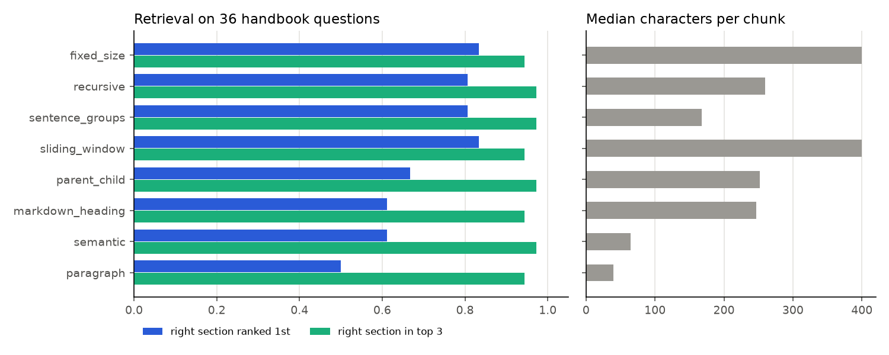
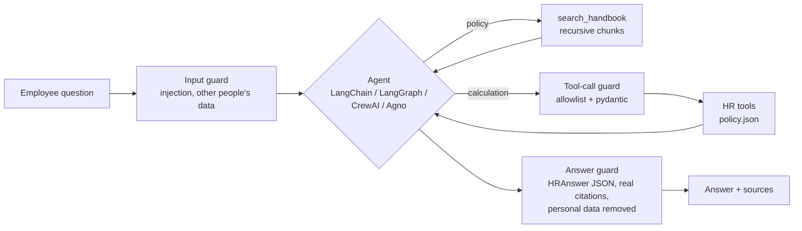
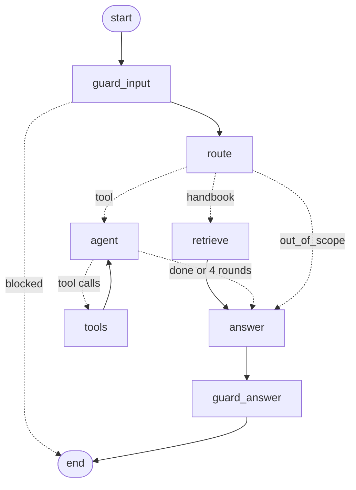
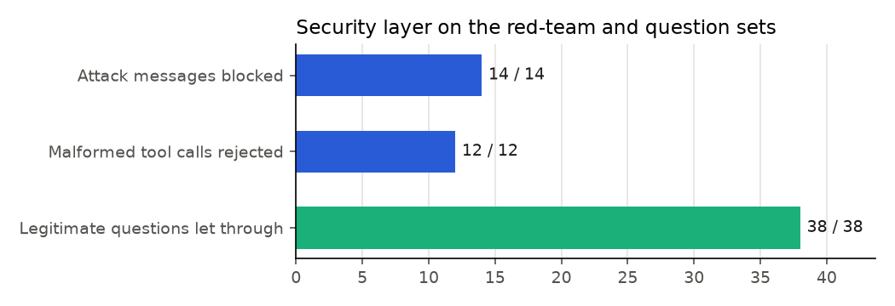

# Agentic HR assistant: one core, four frameworks

**An HR assistant that answers employees' policy questions from the handbook and runs the HR calculations (leave checks, probation dates, payroll cut-off, expense claims, allowances, notice periods), built four ways (LangChain, LangGraph, CrewAI and Agno) on one shared, tested core with a security layer between the LLM and the code.**




## Problem statement

HR teams answer the same questions every day: how much leave is left, when probation ends, whether this month's overtime makes payroll, who approves a large expense claim, what the last day is after resigning. The answers sit in a handbook, and some need a small calculation. An LLM assistant can answer them, but only if it:
- quotes the handbook rather than its general knowledge
- hands every calculation to code instead of doing the arithmetic itself
- refuses requests for other people's data
- never lets a malformed or malicious model output reach the program

## Features

- **RAG over the handbook**, with **eight chunking strategies** compared on a labelled question set
- **Eight HR tools** as plain Python with pydantic-validated inputs; every result is JSON and cites its handbook section
- **A security layer** in three checkpoints: the user's message, each tool call the LLM proposes, and the final answer (a fixed JSON schema with real citations and personal data removed)
- **Four agent versions**, all calling the same tools through the same security layer:
  - **LangChain:** `create_agent`, with retrieval as a tool
  - **LangGraph:** an explicit router graph, loadable in LangGraph Studio
  - **CrewAI:** a hierarchical crew of specialists
  - **Agno:** a route-mode team of specialists
- **Conversation memory** per thread or session, **LangSmith tracing** switched on from `.env`, and a **FastAPI** service
- **Offline tests** that drive the LangChain and LangGraph agents with a scripted model, so CI needs no API key

## Tech stack

| Tool | Used for | Why this one |
|---|---|---|
| LangChain (`create_agent`) | Single-agent version | The model decides whether to retrieve or to calculate; retrieval is just another tool |
| LangGraph | Graph version | Every step is a node you can see, test and trace; a hard limit on tool rounds |
| CrewAI | Hierarchical multi-agent version | A manager delegating to specialists matches how an HR team splits work |
| Agno | Team (route mode) version | Lightweight multi-agent teams with session memory and structured output |
| pydantic | Tool inputs and the `HRAnswer` output schema | The same models validate the LLM's tool calls and its final JSON |
| scikit-learn (TF-IDF) | Offline retrieval and the chunking comparison | Deterministic and free to run, so retrieval quality can be measured in CI |
| LangSmith | Tracing | Every LangChain and LangGraph run traced from `.env`, with no code change |
| FastAPI, pytest, GitHub Actions | API, tests, CI | The course's standard stack |

## Approach



| Stage | Where | Technique | Why this one |
|---|---|---|---|
| Data | `src/data/` | A fictional handbook (19 sections, including the introduction) and `policy.json`; a test checks every policy number also appears in the handbook | The tools and the RAG must never disagree |
| Features | `src/features/` | 8 chunking strategies: fixed size, sliding window, recursive, sentence groups, paragraph, markdown heading, semantic (similarity drop between sentences), parent–child | Compared on the same questions, not chosen by habit |
| Model | `src/models/` | TF-IDF retriever; offline evaluation; live evaluation harness | Measures retrieval, tools and safety without paying for tokens |
| HR tools | `src/core/` | 8 functions, pydantic input models, JSON results citing a section | Arithmetic and dates belong in code, not in the LLM |
| Security layer | `src/security/` | Input guard; tool allowlist with strict schemas (no unknown fields); `HRAnswer` schema, citations checked against real sections, emails, phone numbers and IDs redacted | An LLM's output is untrusted input to the program |
| Agents | `src/agents/` | Four framework versions over one toolkit; CrewAI and Agno specialists get only their own tools | Least privilege; the frameworks are compared on equal terms |
| Deployment | `src/api/` | `/tools/{name}`, `/search` (offline), `/ask` (needs a key) | Use the core without an agent, or ask an agent |

The LangGraph graph:



## Project structure

```
agentic-hr-assistant/
├── data/
│   ├── raw/             handbook.md and policy.json (fictional company)
│   ├── processed/       the handbook's chunks under each strategy
│   └── sample/          policy and 6 sample questions
├── docs/                course_mapping.md: which course topic lives where
├── eval/                questions.jsonl (40 labelled questions), redteam.jsonl (26 attacks and bad tool calls)
├── models/              model card (no trained weights: the LLM is called through its API)
├── notebooks/           01_walkthrough.ipynb: every stage, offline, with outputs
├── reports/             metrics.json, chunking_comparison.csv, tool_results.csv, figures/
├── src/
│   ├── api/             FastAPI service
│   ├── agents/          toolkit, langchain_agent, langgraph_agent, crewai_crew, agno_team
│   ├── core/            hr_tools, settings
│   ├── data/            load_data
│   ├── features/        chunking (8 strategies)
│   ├── models/          retriever, evaluate (offline), live_eval (needs a key)
│   ├── security/        guard
│   ├── utils/           paths, plots
│   └── pipeline.py      offline stages wired together
├── tests/               core, agents (scripted model), API
├── langgraph.json       LangGraph Studio entry point
├── .env.example         keys go in .env, which git ignores
├── requirements.txt     core + LangChain + LangGraph
├── requirements-multiagent.txt   CrewAI + Agno
└── main.py
```

## How it was validated

1. **Policy numbers and handbook agree.** A test checks that every number the tools use also appears in the handbook text that RAG answers from.
2. **Tools against hand-worked answers.** All 12 calculation questions in the set give the expected result and cite the right section. Edge cases are unit-tested too: month-end dates, a change dated after the payroll cut-off moving to the next year, and an over-long probation extension.
3. **Chunking compared on 36 labelled questions.** A hit means a retrieved chunk overlaps the section that answers the question.
4. **The security layer is tested on a red-team set and on the real questions:** 14 attack messages (instruction overrides, requests for colleagues' data, oversized and empty inputs) and 12 malformed tool calls (wrong enum, negative days, unknown fields, unknown tools, broken JSON). It must also *not* block any of the 38 legitimate questions.
5. **The agent wiring is tested without an LLM.** A scripted chat model plays the LLM's part, and the tests check that the LangChain agent and every LangGraph route call the right tool, keep the result in the conversation state, return checked JSON, and reject a fake tool and a made-up citation. The CrewAI and Agno builds are checked for least privilege.
6. **Live evaluation of each framework**, with `python main.py --live <framework>`, scores route accuracy, required facts and correct citations on all 40 questions. It needs an OpenAI key, so it isn't part of CI (see Results).

## Results

| Measure | Result |
|---|---|
| HR tool answers correct (12 calculation questions) | **12 / 12**, each citing the right section |
| Attack messages blocked | **14 / 14** |
| Malformed or unknown tool calls rejected | **12 / 12** |
| Legitimate questions wrongly blocked | **0 / 38** |
| Tests | 33 (32 in the core CI job; the CrewAI/Agno build test runs in the second job) |



**Chunking.** On this short handbook (about 700 words) every strategy finds the right section in the top 3 for 94–97% of questions. The differences are in rank 1 and in how much text each chunk feeds the LLM:
- **Recursive splitting** gives the best balance (rank-1 hit 81%, MRR 0.89, about 260 characters per chunk), so the agents use it.
- **Fixed-size and sliding-window chunks** rank slightly better first (83%), but feed the LLM 400 characters per chunk.
- **Paragraph and semantic chunks** are tiny (40–65 characters) and rank worst.

A longer handbook would separate the strategies more. The comparison script runs unchanged on any markdown handbook.

**Read the security numbers carefully.** The red-team set was written alongside the rules, so 100% shows the rules do what they were written to do, not that they would stop a determined attacker. Keyword guards are a first line of defence. The stronger guarantees come from structure:
- the LLM can only call allowlisted tools with schema-valid arguments
- it can only answer in a fixed JSON shape
- it can only cite sections that exist

**Not yet measured: the live agents.** This repository was built and tested without an LLM API key. The agents are wired and tested with a scripted model, but their accuracy with a real model hasn't been measured here. `python main.py --live langgraph` (or `langchain`, `crewai`, `agno`) produces that report in `reports/live_eval_<framework>.json`.

## What makes it different

- **One core, four frameworks.** The tools, retrieval and security layer are written and tested once. LangChain, LangGraph, CrewAI and Agno are thin layers on top, which makes them comparable and keeps their behaviour consistent.
- **The LLM never does the HR arithmetic,** and never passes an unchecked argument to code.
- **Every answer cites a handbook section that exists,** or it doesn't reach the user.
- **CI needs no API key.** The agent wiring is tested with a scripted model.

## How to run

```bash
python -m venv .venv && source .venv/bin/activate
pip install -r requirements.txt                 # add -r requirements-multiagent.txt for CrewAI and Agno
python main.py                                  # offline: chunking, tools, security layer, figures
pytest                                          # tests (CrewAI/Agno build test skips if not installed)
uvicorn src.api.app:app --reload                # API: /tools and /search work offline

cp .env.example .env                            # add OPENAI_API_KEY (and LangSmith if wanted)
python main.py --ask "I joined on 2026-03-15. When does my probation end?" --framework langgraph
python main.py --live langgraph                 # score an agent on all 40 questions
langgraph dev                                   # optional: open the graph in LangGraph Studio
```

## What I learned

- **Put the rules in code and let the LLM choose and explain.** Every number in an answer comes from a tool or a handbook quote, so the answers can be checked.
- **Treat the model's output as untrusted input.** Schema-validating tool arguments caught wrong enums, negative values and invented fields that would otherwise have reached the code.
- **Tests find the quiet bugs.** The first redaction rule blanked out every ISO date as a "phone number". A retrieved chunk spanning two sections was labelled with the wrong one. Neither showed up until a test asserted the exact answer.
- **The frameworks differ more in control than in capability.** LangGraph makes every step explicit and testable; CrewAI and Agno make delegation easy but harder to pin down. With one shared core, that difference is visible.

## Data note

**The company, the handbook and every policy number are fictional,** written for this repository. No employer data, real HR records or personal data are used. The project was built while taking the ProITBridge Advanced Agentic AI course. The course's HR Assistant projects used the course's own demo handbook and code; this is a rebuild in my own code and does not reproduce course files (see `docs/course_mapping.md`).

## Credits

Built with Claude Code; design, requirements and validation by Raja (Rajayoganandha Sekaran).

Licence: MIT.
